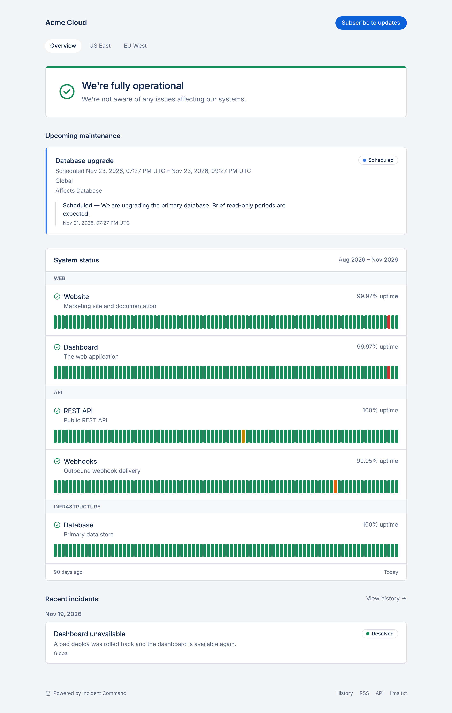
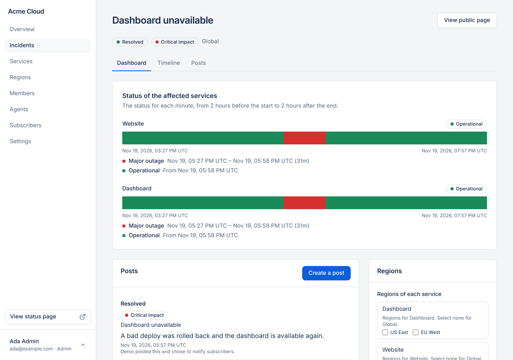
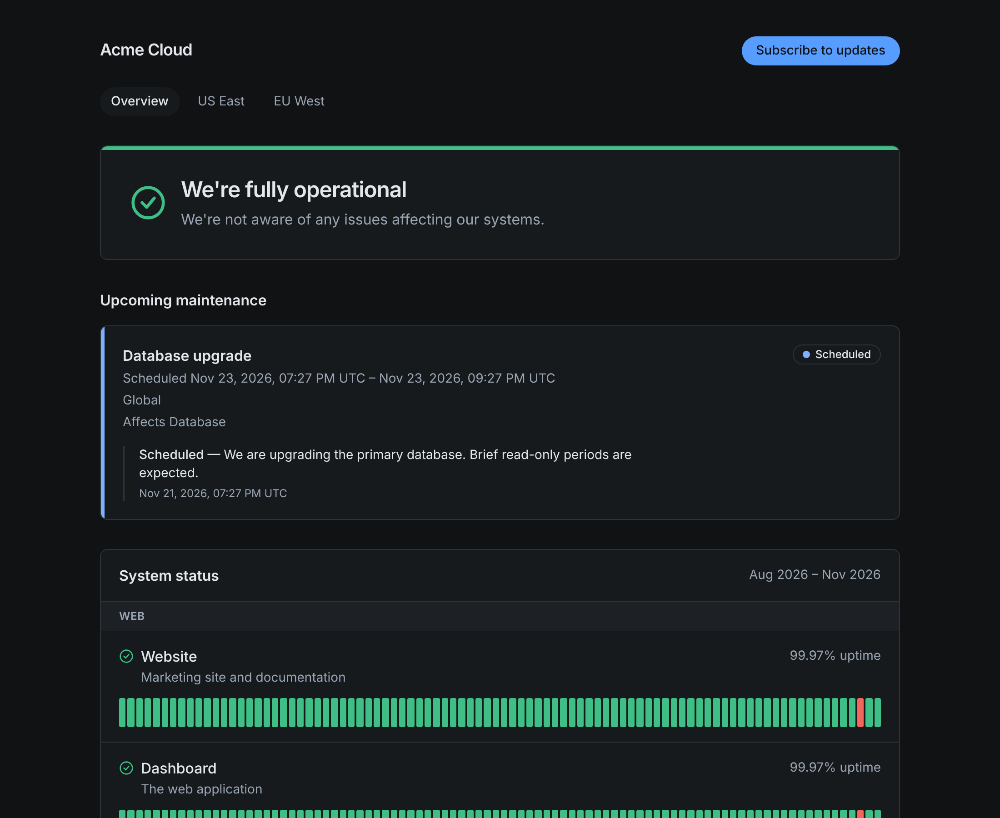

# Incident Command

> Open source incident command: a beautiful, skinnable status page, a management portal for your team, and an MCP server so AI agents can run the whole thing. Deploy it anywhere.

[](https://github.com/jaredwray/incident-command/actions/workflows/tests.yml)
[](https://hub.docker.com/r/jaredwray/incident-command)
[](LICENSE)

**Documentation: [incident-command.org](https://incident-command.org)**



## Features

- **Status page:** an overall status banner, regions, grouped services with 90-day uptime bars, incident history, incident pages with the status of each service for each minute, an RSS feed and a public JSON API. Light and dark mode, mobile friendly.
- **Management portal** at `/manage`: declare incidents, post updates, schedule maintenance, review notification drafts, and manage services, regions, members, agents, subscribers and settings.
- **MCP server** at `/api/mcp`: each agent has its own permissions. A new agent can read the status page and write drafts. It cannot publish or notify subscribers until an admin allows it.
- **Human review of notifications:** an agent saves a notification as a draft. A person approves it before anything goes out.
- **Pages for agents:** `/llms.txt`, `/history.md` and `/incidents/{id}.md` give the status page in Markdown.
- **Notifications** with [airhorn](https://airhorn.org): signed webhooks (Slack and Discord compatible), SendGrid or Amazon SES email, and Twilio or Amazon SNS text messages, with double opt-in.
- **Two-factor authentication** with an authenticator app and recovery codes, required by default.
- **Skinnable:** theme presets, a logo, a favicon and custom CSS from the portal.
- **Pluggable storage:** PostgreSQL, MongoDB or memory, with a [cacheable](https://cacheable.org) read cache that keeps the status page online when the database is offline.

<table>
<tr>
<td></td>
<td></td>
</tr>
</table>

## Quick start

Run the image from Docker Hub with demo data. Replace `<version>` with a [release version](https://hub.docker.com/r/jaredwray/incident-command/tags):

```bash
docker run --rm -p 3000:3000 -e SEED_DEMO=true -e SETUP_TOKEN=change-me jaredwray/incident-command:<version>
```

Open http://localhost:3000 for the status page and http://localhost:3000/manage/setup to create the first admin with the `SETUP_TOKEN`. The image is `linux/amd64`. On an Arm computer, add `--platform linux/amd64`.

With Docker Compose and PostgreSQL:

```bash
cp .env.example .env && docker compose up -d --build
```

From source (Node.js 24 and pnpm, `corepack enable`):

```bash
pnpm install && SEED_DEMO=true SETUP_TOKEN=change-me pnpm dev
```

## Documentation

| Topic           | Link                                                                                                                                                                                                                                                                                                                                                                                                                                                                                      |
| --------------- | ----------------------------------------------------------------------------------------------------------------------------------------------------------------------------------------------------------------------------------------------------------------------------------------------------------------------------------------------------------------------------------------------------------------------------------------------------------------------------------------- |
| Getting started | [Quick start](https://incident-command.org/docs/getting-started/quick-start/) · [Concepts](https://incident-command.org/docs/getting-started/concepts/)                                                                                                                                                                                                                                                                                                                                   |
| Deploy          | [Docker](https://incident-command.org/docs/deploy/docker/) · [Cloudflare](https://incident-command.org/docs/deploy/cloudflare/) · [DigitalOcean](https://incident-command.org/docs/deploy/digitalocean/) · [Google Cloud](https://incident-command.org/docs/deploy/google-cloud/) · [AWS](https://incident-command.org/docs/deploy/aws/) · [Azure](https://incident-command.org/docs/deploy/azure/) · [Fly.io, Render and Railway](https://incident-command.org/docs/deploy/other-hosts/) |
| Operate         | [Databases](https://incident-command.org/docs/operate/databases/) · [Notifications](https://incident-command.org/docs/operate/notifications/) · [Secrets](https://incident-command.org/docs/operate/secrets/) · [Upgrades and backups](https://incident-command.org/docs/operate/upgrades/) · [Security](https://incident-command.org/docs/operate/security/)                                                                                                                             |
| Use the portal  | [User guide](https://incident-command.org/docs/guide/portal/)                                                                                                                                                                                                                                                                                                                                                                                                                             |
| Agents          | [Connect an agent](https://incident-command.org/docs/agents/connect/) · [MCP tools](https://incident-command.org/docs/agents/tools/)                                                                                                                                                                                                                                                                                                                                                      |
| Reference       | [Environment variables](https://incident-command.org/docs/reference/environment-variables/) · [REST API](https://incident-command.org/api/) · [Webhooks](https://incident-command.org/docs/reference/webhooks/)                                                                                                                                                                                                                                                                           |
| Theming         | [Branding](https://incident-command.org/docs/theming/branding/) · [Custom CSS](https://incident-command.org/docs/theming/custom-css/)                                                                                                                                                                                                                                                                                                                                                     |

## Connect an agent

Add the MCP endpoint to your agent. **Manage → Agents** shows the endpoint:

```bash
claude mcp add --transport http incident-command https://status.example.com/api/mcp
```

The agent opens the portal in your browser. Sign in and select **Allow**. Read [Connect an agent](https://incident-command.org/docs/agents/connect/).

## Repository

This repository is a pnpm workspace:

| Path                                   | Contents                                                         |
| -------------------------------------- | ---------------------------------------------------------------- |
| [`packages/app`](packages/app)         | The Next.js app: status page, portal, MCP server and API.        |
| [`packages/website`](packages/website) | The documentation site, built with [docula](https://docula.org). |
| [`deploy`](deploy)                     | Config files for the deploy guides.                              |
| [`Dockerfile`](Dockerfile)             | The container image. Build it from the repository root.          |

```bash
pnpm dev            # start the app in development mode
pnpm test           # vitest with coverage
pnpm lint           # biome
pnpm typecheck      # tsc
pnpm build          # production build (standalone output)
pnpm website:dev    # start the documentation site
```

The test suite enforces **100% line, branch, function and statement coverage** of `packages/app/src`. Read [CONTRIBUTING.md](CONTRIBUTING.md) before you open a pull request.

## License

[MIT](LICENSE) © Jared Wray
